# Results by research question

The results are organized around the evaluation objectives: the perceived quality of the session, the respondent and institutional profile, the feedback participants reported in the open-ended prompts, and the way the two evidence streams relate. All quantitative values below were read from the Conda-generated outputs in `ANALYSIS/outputs/`.

## CRISP-DM 1 — Business understanding

The analysis addressed three decision needs: identify which aspects of the webinar were perceived as strong, identify what participants reported learning or valuing, and identify specific improvements for a subsequent session. The decision prompts were deliberately bounded to immediate participant perceptions and reported feedback; they were not framed as a test of causal learning impact. The handoff prompts are available in [`crispdm_decision_prompts.csv`](../ANALYSIS/outputs/tables/crispdm_decision_prompts.csv).

## CRISP-DM 2 — Data understanding

The analytic grain was one submitted evaluation row. The export contained 52 rows and 24 source fields: 13 primary Likert items, two separate summary ratings, and four open-ended prompts, in addition to administrative and consent fields. The profile and validation outputs are [`crispdm_data_profile.csv`](../ANALYSIS/outputs/tables/crispdm_data_profile.csv) and [`crispdm_validation_summary.csv`](../ANALYSIS/outputs/tables/crispdm_validation_summary.csv). The institution and response-pattern displays below remain descriptive because recorded labels were not harmonized and no verified attendance denominator was available.

## CRISP-DM 3 — Data preparation and normalization

The pipeline parsed the five-point responses into stable analysis fields, generated de-identified row IDs, preserved the raw export, and checked missingness and range validity. Two rows matched the pre-specified scale-direction flag: all 13 primary items were recorded as `1` while both summary ratings were at least `4`. Only those 26 primary-item cells were reverse-normalized with `6 - raw`; the summary ratings were retained as anchors. The field-level audit is [`normalization_audit.csv`](../ANALYSIS/outputs/tables/normalization_audit.csv), and the raw-versus-normalized sensitivity table is [`crispdm_normalization_sensitivity.csv`](../ANALYSIS/outputs/tables/crispdm_normalization_sensitivity.csv).

## CRISP-DM 4 — Descriptive modeling and analysis

In this evaluation, modeling meant descriptive and exploratory analysis rather than prediction. The figures and tables below report normalized Likert distributions, bootstrap intervals for item means, Wilson intervals for agreement proportions, a descriptive respondent-level composite, an ordinal cross-tabulation, and analyst-coded themes.

### Evaluation of the session experience

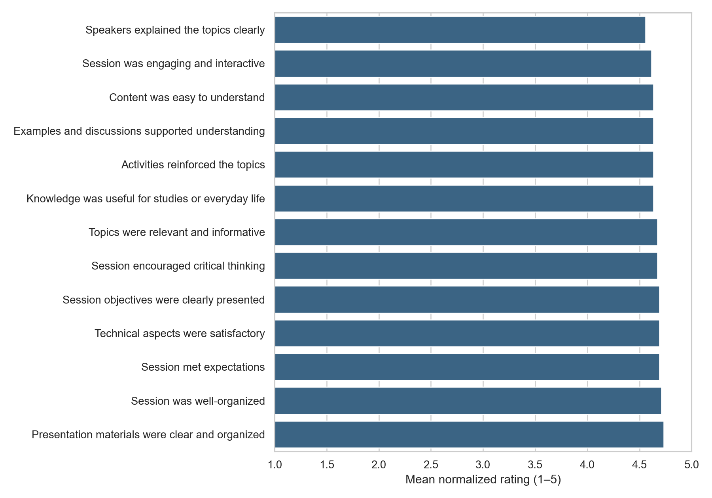

*Figure 3.1. Normalized means for the 13 primary Likert items with deterministic bootstrap 95% intervals. The display supports within-sample comparison and does not represent population-level inference.*

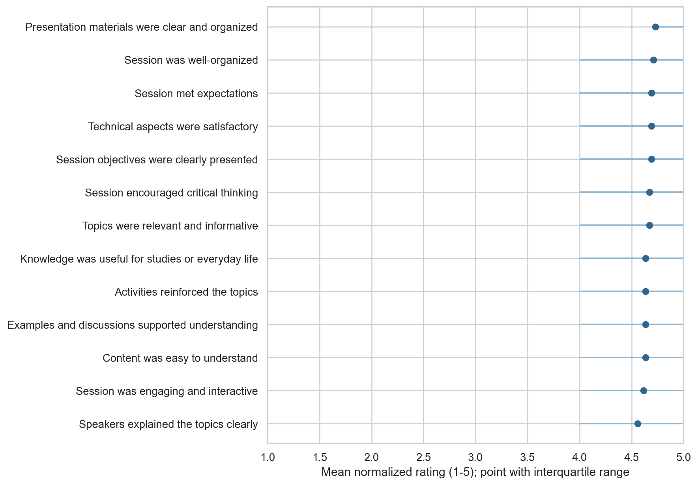

*Figure 3.2. Primary-item means with interquartile ranges, showing the concentration of responses on the upper end of the five-point scale.*

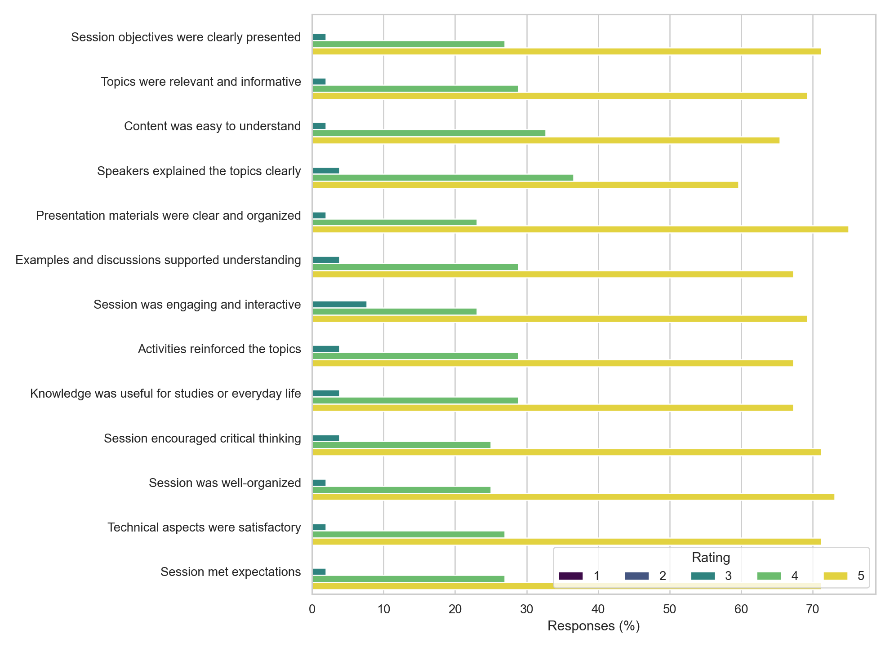

*Figure 3.3. Percentage distribution of ratings 1 through 5 for each primary item after the documented respondent-level normalization.*

The 13 primary statements were summarized on the normalized 1-5 Likert scale. The agreement rate uses the pre-specified threshold of 4 or 5. The top-box rate is the percentage selecting 5. The full metric file also contains bootstrap 95% intervals for item means and Wilson 95% intervals for agreement proportions.

| Primary item | Mean | SD | Agreement (4 or 5) | Top-box (5) |
| --- | ---: | ---: | ---: | ---: |
| Session objectives were clearly presented | 4.6923 | 0.5064 | 98.08% | 71.15% |
| Topics were relevant and informative | 4.6731 | 0.5134 | 98.08% | 69.23% |
| Content was easy to understand | 4.6346 | 0.5250 | 98.08% | 65.38% |
| Speakers explained the topics clearly | 4.5577 | 0.5744 | 96.15% | 59.62% |
| Presentation materials were clear and organized | 4.7308 | 0.4897 | 98.08% | 75.00% |
| Examples and discussions supported understanding | 4.6346 | 0.5611 | 96.15% | 67.31% |
| Session was engaging and interactive | 4.6154 | 0.6310 | 92.31% | 69.23% |
| Activities reinforced the topics | 4.6346 | 0.5611 | 96.15% | 67.31% |
| Knowledge was useful for studies or everyday life | 4.6346 | 0.5611 | 96.15% | 67.31% |
| Session encouraged critical thinking | 4.6731 | 0.5503 | 96.15% | 71.15% |
| Session was well-organized | 4.7115 | 0.4985 | 98.08% | 73.08% |
| Technical aspects were satisfactory | 4.6923 | 0.5064 | 98.08% | 71.15% |
| Session met expectations | 4.6923 | 0.5064 | 98.08% | 71.15% |

The item means ranged from 4.5577 to 4.7308. Presentation materials received the highest mean and top-box rate, while speaker clarity received the lowest mean and top-box rate. The engagement item had the lowest agreement rate at 92.31%, although it still had a high mean of 4.6154. These rankings identify relative differences within this respondent set; they do not establish meaningful population differences or a causal hierarchy among session components. The source table is [`crispdm_quantitative_metrics.csv`](../ANALYSIS/outputs/tables/crispdm_quantitative_metrics.csv), with the response distribution in [`likert_distributions.csv`](../ANALYSIS/outputs/tables/likert_distributions.csv).

The CRISP-DM metric output also shows why the ranking should be interpreted cautiously. The bootstrap interval for presentation materials was 4.5962-4.8654, while the interval for speaker clarity was 4.4038-4.7115; the intervals overlap. Thus, the output supports a descriptive ordering of dimensions, not a claim that materials performed significantly better than clarity. The Wilson interval for engagement agreement was 81.83%-96.97%, which retains uncertainty around the observed 92.31% proportion in this available respondent set.

The separate summary ratings were also favorable:

| Summary item | Mean | SD | Agreement (4 or 5) | Top-box (5) |
| --- | ---: | ---: | ---: | ---: |
| Overall session rating | 4.6154 | 0.5297 | 98.08% (51/52) | 63.46% (33/52) |
| Satisfaction | 4.6731 | 0.5134 | 98.08% (51/52) | 69.23% (36/52) |

The primary-item composite had a mean of 4.6598 (SD = 0.4390; median = 4.9231), and 94.23% of respondents had a composite score of at least 4. This composite is a descriptive summary of the 13 items, not a validated psychometric scale. The composite output is [`crispdm_composite_summary.csv`](../ANALYSIS/outputs/tables/crispdm_composite_summary.csv).

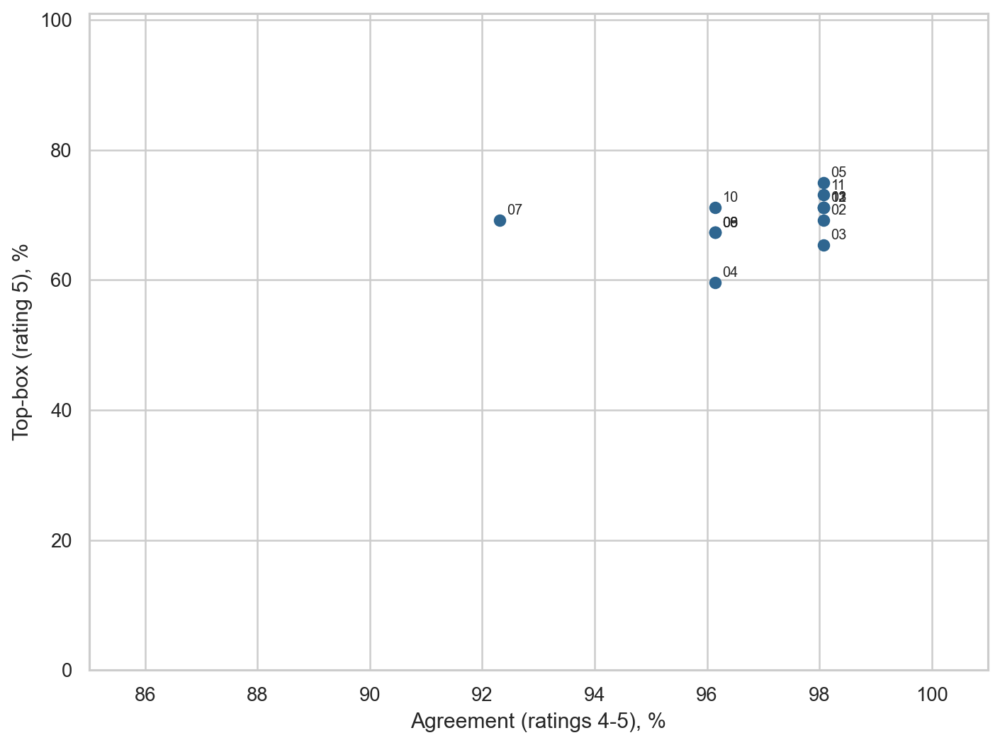

*Figure 3.4. Agreement percentages (ratings 4-5) compared with top-box percentages (rating 5) for the primary items. Labels identify item numbers and do not imply ranking significance.*

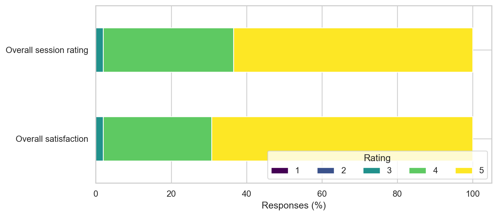

*Figure 3.5. Response distributions for the overall session rating and overall satisfaction items.*

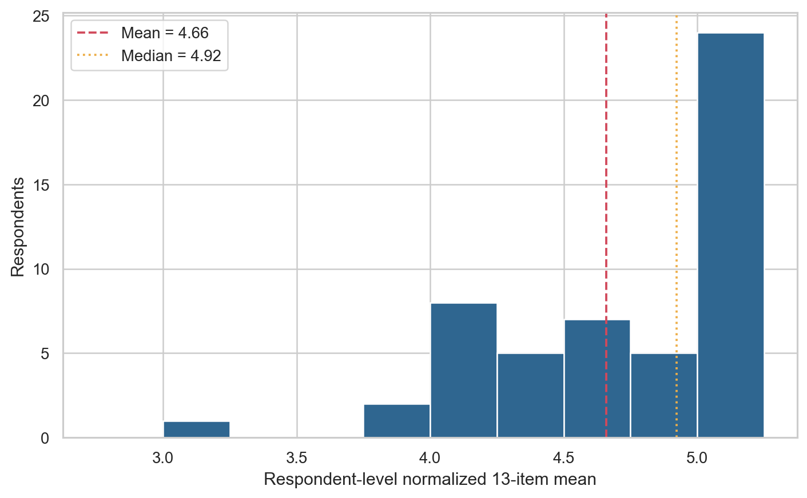

*Figure 3.6. Distribution of respondent-level means across the 13 normalized primary items, with the sample mean and median marked.*

### Respondent and institutional profile

The analysis included 52 available evaluation responses. The institution field was retained as recorded for descriptive reporting. `Gordon College` appeared as the exact recorded value for 37 responses (71.15%). Fifteen other recorded categories appeared once each (1.92% per category), including capitalization and spelling variants of Gordon College, other institutions, one unspecified response, and one `Prefer not to say` response. Because institution labels were not harmonized in the pipeline, these values should not be added to produce an inferred institutional total. The complete output is [`crispdm_institution_summary.csv`](../ANALYSIS/outputs/tables/crispdm_institution_summary.csv).

The dataset contained no missing rating cells and no out-of-range rating cells. Two duplicate timestamp values were retained because timestamps were not used as respondent identifiers. The data-quality record is available in [`crispdm_validation_summary.csv`](../ANALYSIS/outputs/tables/crispdm_validation_summary.csv).

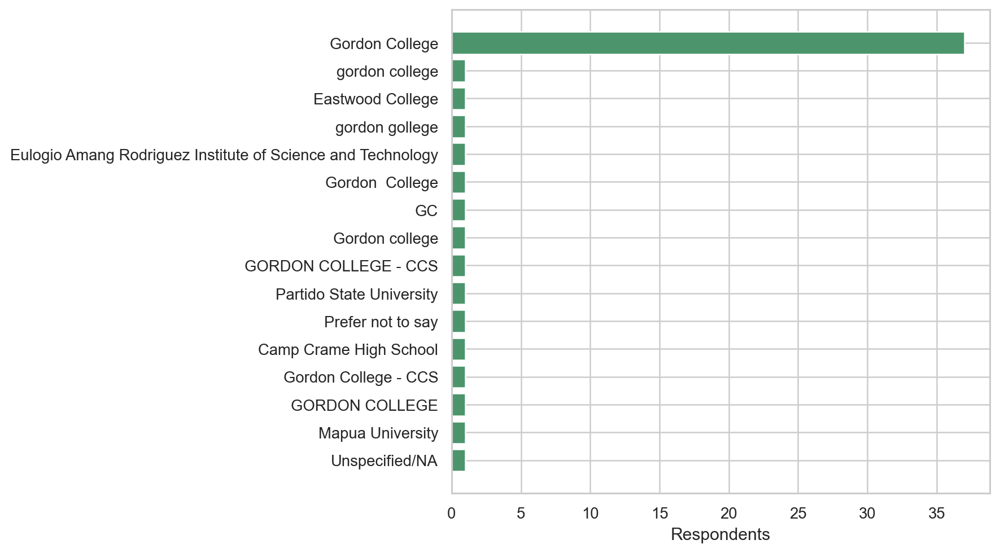

*Figure 3.7. Exact institution labels as recorded in the export. Capitalization and spelling variants remain separate, so the figure is a data-profile display rather than a harmonized institutional count.*

### Speaker clarity and overall rating

The cross-tabulation below examines speaker clarity against the overall rating. It is descriptive and does not imply that clarity caused the overall rating.

| Speaker clarity response | *n* | Mean overall rating | Overall rating of 5 | Top-box rate |
| --- | ---: | ---: | ---: | ---: |
| 3 | 2 | 3.5000 | 0/2 | 0.00% |
| 4 | 19 | 4.3684 | 7/19 | 36.84% |
| 5 - Strongly agree | 31 | 4.8387 | 26/31 | 83.87% |

The ordinal association between speaker clarity and overall rating was Spearman rho = **0.5459** across 52 complete cases. This positive association is compatible with the idea that perceptions of delivery and overall evaluation moved together in this dataset, but the post-event design cannot distinguish association from confounding or response-style effects. The underlying tables are [`crispdm_speaker_clarity_overall_crosstab.csv`](../ANALYSIS/outputs/tables/crispdm_speaker_clarity_overall_crosstab.csv), [`crispdm_speaker_clarity_overall_summary.csv`](../ANALYSIS/outputs/tables/crispdm_speaker_clarity_overall_summary.csv), and [`crispdm_association_summary.csv`](../ANALYSIS/outputs/tables/crispdm_association_summary.csv).

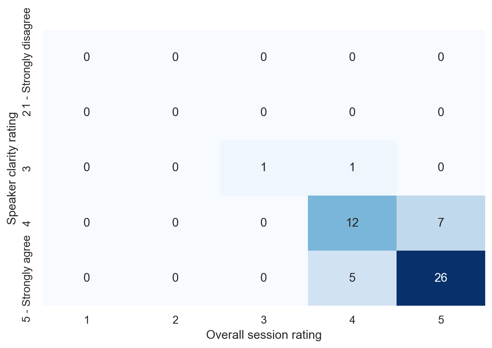

*Figure 3.8. Counts in the cross-tabulation of speaker-clarity and overall-session-rating responses. The heatmap visualizes association and does not imply causation.*

### Open-ended feedback

The qualitative unit was one respondent answer to one open-ended prompt. Multiple codes could be assigned to one answer. The resulting counts are therefore coded assignments and respondent coverage, not mutually exclusive participant categories.

| Code | Description | Assignments | Respondents |
| --- | --- | ---: | ---: |
| `LEARNING_AI_USE` | AI use | 36 | 25 |
| `LEARNING_SOFTWARE_DEVELOPMENT` | Software development | 22 | 21 |
| `LEARNING_TDD_TESTING` | TDD or software testing | 21 | 17 |
| `VALUED_EXPLANATION` | Explanation and clarity | 17 | 17 |
| `VALUED_DEMONSTRATION` | Demonstration | 11 | 11 |
| `VALUED_PRACTICALITY` | Practical relevance | 11 | 9 |
| `OTHER_RELEVANT_FEEDBACK` | Other relevant feedback | 9 | 7 |
| `IMPROVEMENT_MORE_EXAMPLES` | More examples | 7 | 7 |
| `IMPROVEMENT_MORE_INTERACTION` | More interaction | 6 | 5 |
| `VALUED_SPEAKER` | Speaker | 5 | 5 |
| `IMPROVEMENT_MORE_DEPTH` | More depth | 4 | 4 |
| `IMPROVEMENT_TECHNICAL_QUALITY` | Technical quality | 2 | 2 |

AI use was the most frequent substantive code, followed by broader software-development comments and TDD or testing comments. Explanation and clarity was the most frequent valued-delivery code. Requests for more examples and more interaction were the most frequent improvement codes. Technical-quality comments were less frequent, with two assignments involving two respondents. The coding output with respondent denominators is [`crispdm_theme_counts_with_denominators.csv`](../ANALYSIS/outputs/tables/crispdm_theme_counts_with_denominators.csv).

The coding record also marked 99 assignments as `NO_SUBSTANTIVE_RESPONSE`, involving 47 respondents across the four prompts. These counts are not additional findings about satisfaction; they document the amount of non-substantive material in the qualitative stream. By prompt, the no-substantive code appeared 9 times for learning-value responses, 10 times for liked-most responses, 38 times for improvement responses, and 42 times for additional comments. The prompt-by-code table is [`crispdm_theme_by_prompt.csv`](../ANALYSIS/outputs/tables/crispdm_theme_by_prompt.csv).

The prompt-level CRISP-DM output changes the meaning of the aggregate theme ranking. Learning-value responses were concentrated in AI use (22 assignments), software development (21), and TDD/testing (14). Liked-most responses emphasized explanation and clarity (17), AI use (14), and demonstrations (11). Improvement responses emphasized more examples (7), more interaction (5), and more depth (3). Additional comments contained 42 no-substantive assignments, so that prompt was less informative for explaining the session than the other three. These are coded assignments rather than mutually exclusive respondent categories; the complete prompt matrix is [`crispdm_theme_by_prompt.csv`](../ANALYSIS/outputs/tables/crispdm_theme_by_prompt.csv).

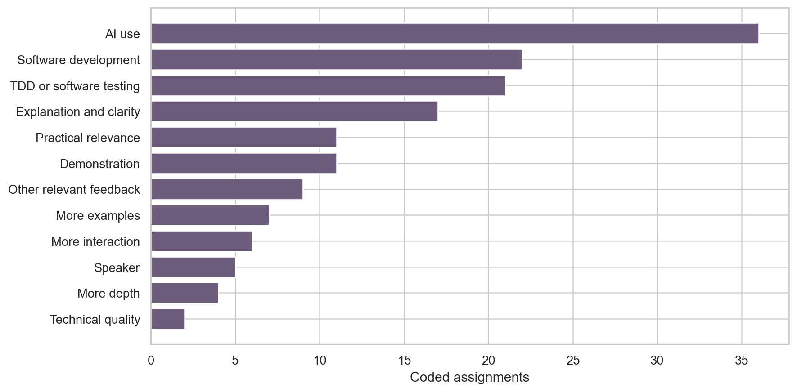

*Figure 3.9. Frequencies of substantive coded assignments. Codes were not mutually exclusive, so assignment counts cannot be summed as if they represented unique participants.*

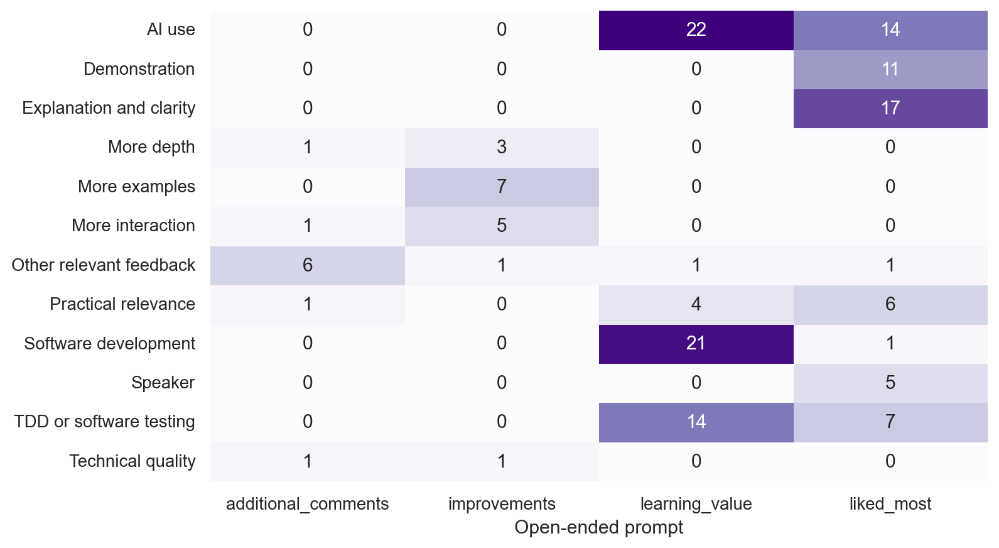

*Figure 3.10. Distribution of substantive codes across the four open-ended prompts. The no-substantive code is excluded from this display to keep the substantive patterns readable.*

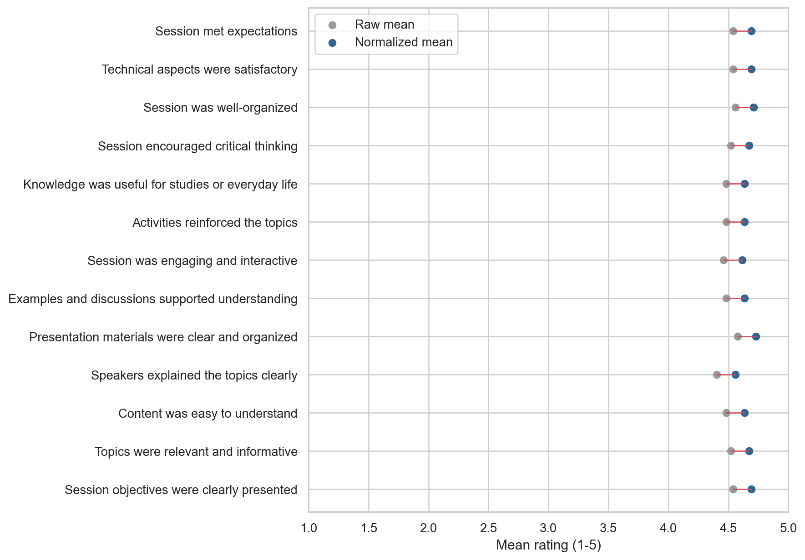

*Figure 3.11. Raw and normalized primary-item means. The paired points show the descriptive effect of reversing the two flagged respondents' primary Likert entries from 1 to 5; summary anchors were not changed.*

## CRISP-DM 5 — Evaluation and mixed-methods integration

The evaluation phase checked whether the prepared data remained valid, whether the normalization decision materially changed the descriptive pattern, and whether the quantitative and qualitative strands supplied complementary evidence. The validation record is [`crispdm_validation_summary.csv`](../ANALYSIS/outputs/tables/crispdm_validation_summary.csv), the sensitivity table is [`crispdm_normalization_sensitivity.csv`](../ANALYSIS/outputs/tables/crispdm_normalization_sensitivity.csv), and the integrated evidence matrix is [`mixed_methods_evidence_matrix.csv`](../ANALYSIS/outputs/tables/mixed_methods_evidence_matrix.csv).

### Integration of the two strands

The two evidence streams pointed in a broadly similar direction. Ratings were high across the 13 primary items, while the comments most often referred to AI use, software development, testing, clarity, demonstrations, and practical relevance. The qualitative material also added information that the rating averages could not show: some respondents wanted more examples, more interaction, more depth, or improved technical quality. The resulting interpretation is therefore positive but not unqualified. Participants generally reported a favorable experience, while the coded feedback identified concrete ways to increase practice and participation. The generated mixed-methods matrix is available in [`mixed_methods_evidence_matrix.csv`](../ANALYSIS/outputs/tables/mixed_methods_evidence_matrix.csv).

## CRISP-DM 6 — Deployment and decision handoff

The deployment phase translated the verified outputs into bounded decision cues for the next webinar or evaluation cycle. These are handoff recommendations, not causal claims about what will improve learning.

| Decision cue | Evidence from this evaluation | Handoff implication |
| --- | --- | --- |
| Retain or showcase strengths | Presentation materials: mean 4.7308, 98.08% agreement, 75.00% top-box; organization: mean 4.7115 ([quantitative metrics](../ANALYSIS/outputs/tables/crispdm_quantitative_metrics.csv)). | Preserve the clear structure, explicit objectives, and organized materials. |
| Add practice and participation | More examples: 7 assignments/7 respondents; more interaction: 6 assignments/5 respondents; engagement had the lowest agreement rate at 92.31% ([theme counts](../ANALYSIS/outputs/tables/crispdm_theme_counts_with_denominators.csv); [quantitative metrics](../ANALYSIS/outputs/tables/crispdm_quantitative_metrics.csv)). | Add guided examples, interactive debugging, or test-writing practice, then evaluate the next session separately. |
| Protect measurement quality | Two scale-direction flags produced 26 documented primary-item corrections ([normalization audit](../ANALYSIS/outputs/tables/normalization_audit.csv)). | Keep visual scale-direction cues and preserve the normalization audit with future reports. |
| Preserve mixed-methods interpretation | The evidence matrix separates numeric perception measures from coded reported feedback ([mixed-methods matrix](../ANALYSIS/outputs/tables/mixed_methods_evidence_matrix.csv)). | Continue reporting ratings, respondent coverage, and coded assignments together without treating either as objective learning evidence. |

The formal decision-prompt output is [`crispdm_decision_prompts.csv`](../ANALYSIS/outputs/tables/crispdm_decision_prompts.csv); the broader implications are developed in [`04-implications.md`](04-implications.md).
